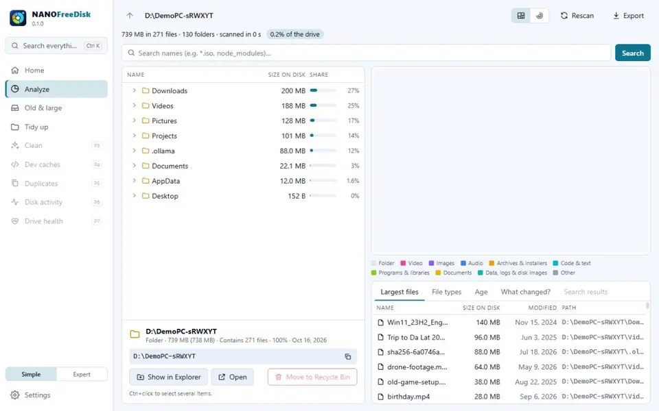
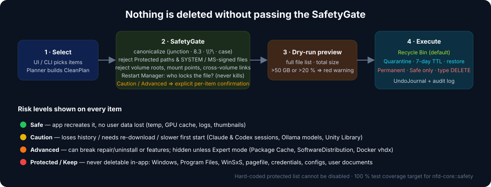
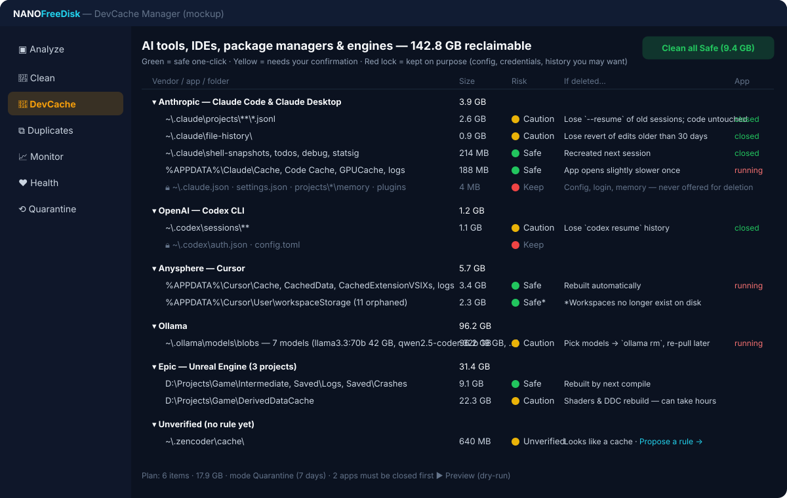
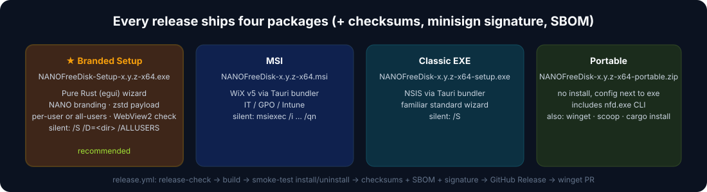
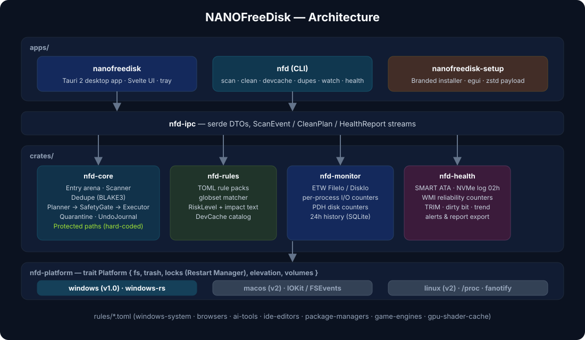

<p align="center">
  
</p>

<p align="center">
  <a href="https://github.com/congluuit/NANOFreeDisk/actions/workflows/ci.yml"></a>
  <a href="https://github.com/congluuit/NANOFreeDisk/actions/workflows/release.yml"></a>
  <a href="https://github.com/congluuit/NANOFreeDisk/releases/latest"></a>
  <a href="https://github.com/congluuit/NANOFreeDisk/releases"></a>
  <a href="LICENSE"></a>
  
  
</p>

<p align="center">
  <b>NANOFreeDisk</b> is a fast, open-source disk analyzer and safe cleaner for Windows, written in Rust.<br>
  It shows where your space went, finds junk and duplicates, explains exactly what every AI/IDE cache folder is and what happens if you delete it,
  watches live disk activity per process, and keeps an eye on drive health — <b>without ever touching files Windows or your tools depend on</b>.<br>
  <sub>v1.0 is a disk analyzer; the roadmap grows it into a complete, safe <b>Windows workspace manager</b> for developers and gamers.</sub>
</p>

<p align="center">
  <a href="#-download">Download</a> ·
  <a href="#-features">Features</a> ·
  <a href="#-safety-first">Safety</a> ·
  <a href="#-devcache-manager">DevCache</a> ·
  <a href="#-cli">CLI</a> ·
  <a href="#-build-from-source">Build</a> ·
  <a href="#-roadmap">Roadmap</a> ·
  <a href="#-contributing">Contributing</a> ·
  <a href="docs/PLAN.md">Development plan (vi)</a>
</p>

> **Status:** 🚧 pre-alpha — the scanner, the `nfd scan` CLI and the first slice of the desktop app (drive overview, treemap/sunburst, search, safe Recycle Bin, EN/VI, themes) work; cleaning, DevCache, health and installers are next. Star/watch the repo to follow releases.

---

## ✨ Features

| | Pillar | What you get |
|---|---|---|
| 📊 | **Analyze** | Treemap, sunburst and sortable tree of any drive or folder. NTFS fast path reads the MFT (WizTree-class speed, ~1M files in seconds). Understands hardlinks, junctions, sparse/compressed files and OneDrive cloud placeholders, so numbers add up. |
| 🧹 | **Clean** | Rule-based junk detection: Windows temp & logs, crash dumps, thumbnail caches, browser caches, GPU shader caches, build artifacts (`target/`, `node_modules/`, `Library/`, `DerivedDataCache/`…). Every item carries a **risk level** and a plain-language **"if you delete this…"** note. |
| 🤖 | **DevCache** | A curated catalog of the temp/cache/session folders left behind by **Claude Code, Claude Desktop, OpenAI Codex, ChatGPT, Gemini CLI, GitHub Copilot, Cursor, Windsurf, Cline/Roo, Continue, Zed, Kiro, Trae, Ollama, LM Studio, Hugging Face, VS Code, JetBrains, Visual Studio, npm/pnpm/pip/uv/cargo/go/NuGet/Gradle, Unity, Unreal, Godot**… Shows what is safe, what costs you history or a re-download, and what is deliberately kept (configs, credentials, memory). |
| ⧉ | **Duplicates** | Size → partial BLAKE3 → full BLAKE3 pipeline with a hash cache, gentle on the PC (background I/O priority, one file at a time on hard disks), never downloads cloud placeholders. Identical files and identical folders; keep the oldest / newest / a preferred folder, send the rest to the Recycle Bin, or replace them with NTFS hard links / ReFS block clones — every copy re-checked byte for byte right before it moves, and everything restorable. |
| 📈 | **Monitor** | Real-time disk activity via ETW: which process reads/writes what, throughput, IOPS, queue length, latency, top files being written. Spots runaway loggers, indexers and sync clients. |
| ♥ | **Health** | S.M.A.R.T. (ATA) and NVMe health log, temperature, wear, reallocated/pending sectors, TRIM status, dirty volumes, free-space trend with "disk full in N days" forecast, tray alerts, exportable report. |
| ⌨ | **CLI** | Everything above as `nfd` for scripts and CI: `nfd scan`, `nfd clean --dry-run`, `nfd devcache`, `nfd dupes`, `nfd watch`, `nfd health`. |

### Also in v1.0 — the "easy to use" layer

| | Feature | Why |
|---|---|---|
| 💯 | **Health Score home page** (0–100) with three big buttons: *Free X GB safely now*, *What is eating my disk*, *Is my drive healthy* — every point lost has a **Fix** button | One number, three clicks, no manual |
| 🔀 | **"What changed?"** — diff two scans (today vs. last week): which folders grew, which files are new, how many GB | Answers "why did C: fill up by itself?" |
| 📖 | **Folder Encyclopedia** — click any system/app folder (WinSxS, `AppData\Local\Packages`, `Package Cache`, `.ollama`…) and get *What is this? Can I delete it? What happens if I do?* Community-editable | Nobody has to Google again |
| 🗂 | **Repo Finder** — every git repo on the drive with `.git` vs build-artifact size (`target/`, `node_modules/`, `Library/`, `DerivedDataCache/`, `bin/obj`, `.venv`…), last commit, uncommitted changes; clean artifacts to quarantine, `git gc`, archive | npkill + cargo-sweep + Unity cleaner for every language, one screen |
| 🧰 | **Toolchain Inventory** — rustup toolchains, Node versions, Python/conda envs, JDKs, .NET SDKs, Android SDK images, Visual Studio workloads, Unity editors, Unreal versions — size, last used and the **proper uninstall command** | Dev machines carry 3–5 unused versions of everything |
| 📦 | **Package-store cleanup via vendor CLIs** — `pnpm store prune`, `npm cache verify`, `cargo-cache`, `uv/pip cache`, `nuget locals`, `go clean -modcache`, `conda clean`, `hf cache`, `ollama rm` | The store never breaks because the right command did the work |
| 👤 | **Profiles** — Developer / Gamer / Office / Minimal pick rule sets and thresholds during a 60-second onboarding | Usable before reading any docs |
| 🎚 | **Simple / Expert mode** — Simple hides Advanced rules and raw SMART; Expert shows everything plus the equivalent CLI command for each action | Grows with the user |
| ⌘ | **Command palette (Ctrl+K)**, keyboard-first, search across drives, folders, rules and settings | Fast for power users |
| ⏪ | **Time Machine** — an activity log of everything the app did, with one-click Restore (Recycle Bin, Quarantine, toggles) | Nothing is ever truly gone |
| 🌐 | **English & Vietnamese everywhere** — UI, CLI, installer, tray and every "if you delete this…" note; more languages via PR | Built in from day one, CI checks both locales stay complete |
| 🎨 | **Light / Dark / System / Custom theme** — Custom lets you pick your own colours (background, accent, risk colours, treemap palette) with live preview, presets and `theme.toml` import/export | Your tool, your look |
| 🔔 | Old & Large finder, empty folders & broken shortcuts, scheduled 🟢-only cleaning, Recycle Bin manager, folder quotas & alerts, free-space forecast, HTML report export, tray with per-drive free space, Explorer context menu, no telemetry | Small things that add up |

<p align="center">
  <br>
  <sub>The real app on a synthetic demo drive (recorded by <code>scripts/demo-video.mjs</code>; <a href="docs/assets/demo/nanofreedisk-demo.gif">GIF version</a>).</sub>
</p>

---

## 🛡 Safety first

NANOFreeDisk is built around one rule: **a cleaner must never be the reason Windows or your tools stop working.**

<p align="center">
  
</p>

- **Hard-coded protected list that cannot be disabled** — `C:\Windows`, `Program Files`, `WinSxS`, `System32`, `pagefile.sys`, `hiberfil.sys`, `System Volume Information`, `$Recycle.Bin`, EFI/Recovery, your Documents/Desktop/Pictures, and the config/credential files of every tool in the catalog (`~/.claude.json`, `~/.codex/auth.json`, `~/.ssh`, `.env`, …).
- **Path canonicalization before every check** — junctions, symlinks, 8.3 names, `\\?\` prefixes and case tricks cannot route a delete into a protected folder.
- **Files in use are never force-deleted** — the Windows Restart Manager tells you *which* process holds a file; the app never kills anything.
- **Microsoft-signed and SYSTEM-attributed files** inside system folders are always protected, even if a rule matches.
- **Recycle Bin by default, Quarantine for big caches** — large cache folders are *moved* (instant rename) into a quarantine with a 7-day TTL and a one-click *Restore*. Permanent deletion is only offered for 🟢 Safe items and requires typing `DELETE`.
- **Dry-run first, always** — every plan shows the complete file list and total before anything happens; plans over 50 GB or 20 % of the drive get a red warning.
- **Undo journal + audit log** — every operation is recorded; `nfd quarantine restore <id>` brings it back.
- **No telemetry.** The only network calls are the optional update check and documentation links.

Risk levels shown on every item:

| Level | Meaning | Examples |
|---|---|---|
| 🟢 **Safe** | Recreated automatically; no user data or history lost | `%TEMP%`, GPU shader caches, Electron `Cache/` dirs, thumbnails, old logs |
| 🟡 **Caution** | Loses history, needs re-download, or slows the next start | Claude/Codex session transcripts, Ollama models, Unity `Library/`, Unreal `DerivedDataCache/` |
| 🟠 **Advanced** | Can break repair/uninstall or features; hidden unless Expert mode | `ProgramData\Package Cache`, `SoftwareDistribution\Download`, Docker `ext4.vhdx` |
| 🔴 **Protected / Keep** | Never offered for deletion; the app only *explains* the proper system tool | WinSxS → DISM, hiberfil → `powercfg /h off`, restore points → System Protection, configs & credentials |

---

## 🤖 DevCache Manager

Developer machines fill up with caches nobody dares to delete. NANOFreeDisk ships a maintained catalog (see [`docs/DEVTOOL_CACHE_CATALOG.md`](docs/DEVTOOL_CACHE_CATALOG.md) and the TOML rule packs in [`rules/`](rules/)) that answers three questions for each folder: **Can I delete it? What do I lose? Which app must be closed?**

<p align="center">
  
</p>

A few examples from the catalog:

| Folder | Level | If you delete it… |
|---|---|---|
| `~\.claude\projects\`, `~\.codex\sessions\`, `~\.gemini\tmp\`, `~\.gemini\antigravity\`, VS Code / Cursor / Windsurf / Devin `workspaceStorage`, … | 🔴 | Kept — the conversation history of AI agents is **never** deleted, by any feature (rules, DevCache, Duplicates or by hand). |
| `~\.claude.json`, `settings.json`, `~\.codex\auth.json` | 🔴 | Kept — login, permissions and configuration. |
| `~\.claude\file-history\` | 🟡 | You can no longer revert old Claude Code edits. Your code is untouched. |
| `%APPDATA%\Cursor\Cache`, `CachedData`, `logs` | 🟢 | Rebuilt on next start. `User\globalStorage\state.vscdb` (chat history) is kept. |
| `~\.ollama\models\blobs` | 🟡 | Re-download required — the app lets you pick individual models instead. |
| `%LOCALAPPDATA%\JetBrains\<IDE>\caches`, `index` | 🟢 | IDE re-indexes the project once. |
| `<project>\Library\` (Unity) | 🟡 | Full asset re-import on next open (can take hours). Assets are not lost. |
| `<project>\DerivedDataCache\` (Unreal) | 🟡 | Shaders and derived data rebuild. |
| `%ProgramData%\Package Cache` | 🟠 | VC++/.NET/VS repair & uninstall may need the original installer again. |

Unknown dot-folders that *look* like caches are shown as 🟡 **Unverified** with a one-click "propose a rule" link — they are never part of one-click cleaning. Adding a vendor is a TOML entry plus a test; see [CONTRIBUTING.md](CONTRIBUTING.md).

---

## ⬇ Download

<p align="center">
  
</p>

Grab the latest build from the [Releases page](https://github.com/congluuit/NANOFreeDisk/releases/latest):

| Package | File | Notes |
|---|---|---|
| ★ **Branded setup** (recommended) | `NANOFreeDisk-Setup-<ver>-x64.exe` | NANO-branded installer written in Rust. Per-user (no admin) or all-users. Silent: `/S /D=C:\Apps\NANOFreeDisk /ALLUSERS` |
| MSI | `NANOFreeDisk-<ver>-x64.msi` | Standard Windows Installer for IT/GPO/Intune. Silent: `msiexec /i NANOFreeDisk-<ver>-x64.msi /qn` |
| Classic EXE | `NANOFreeDisk-<ver>-x64-setup.exe` | Standard NSIS wizard. Silent: `/S` |
| Portable | `NANOFreeDisk-<ver>-x64-portable.zip` | Unzip and run; config lives next to the exe. Includes `nfd.exe` CLI. |

Also (after 1.0): `winget install NANODev.NANOFreeDisk` · `scoop install nanofreedisk` · `cargo install nfd-cli`

**Verify a download:** every release includes `SHA256SUMS.txt` and a minisign signature `SHA256SUMS.txt.minisig`.

```powershell
Get-FileHash .\NANOFreeDisk-Setup-1.0.0-x64.exe -Algorithm SHA256
```

Requirements: Windows 10 1809+ / Windows 11, x64. The GUI uses the WebView2 runtime (preinstalled on Windows 11; the installer fetches it on Windows 10 if missing). Admin rights are only requested for the optional MFT fast scan, ETW monitoring, SMART over IOCTL and system-junk cleanup.

---

## ⌨ CLI

```text
nfd scan <path> [--fast] [--top N] [--json|--csv] [--min-size 10MB]
nfd clean [--rules ai-tools,browsers] [--level safe] [--dry-run] [--mode recycle|quarantine]
nfd devcache [list|clean --vendor anthropic --level safe|unknown]
nfd toolchains [--json]
nfd repos <root> [--keep-recent 7] [--json]   ·   nfd repos clean <root> [--apply]
nfd stores [--json]   ·   nfd stores run npm-cache-clean
nfd dupes <path...> [--min-size 1MB] [--folders] [--keep auto|oldest|newest|prefer:<dir>] [--action list|recycle|quarantine|hardlink] [--apply]
nfd watch [--interval 1s] [--top 20]
nfd health [--json] [--raw] [--disk N]          # exit code 1 = caution, 2 = bad
nfd quarantine [list|restore <id>|purge --older 7d]
nfd rules [list|validate <dir>]
```

```powershell
# what would a safe clean of AI-tool caches free up? (nothing is deleted)
nfd clean --rules ai-tools --level safe --dry-run
```

---

## 🏗 Architecture

<p align="center">
  
</p>

- **`nfd-core`** — entry arena, parallel scanner (+ NTFS MFT fast path), dedupe, the `Planner → SafetyGate → Executor` pipeline, quarantine and undo journal. UI-agnostic; 100 % test-coverage target for `safety`.
- **`nfd-rules`** — TOML rule-pack loader, glob matcher, risk levels, DevCache catalog.
- **`nfd-monitor`** — ETW consumers, per-process I/O counters, PDH disk counters.
- **`nfd-health`** — SMART/NVMe via IOCTL (NVMe without admin rights), CrystalDiskInfo-style verdicts, volume checks, alerts.
- **`nfd-platform`** — the `Platform` trait; Windows implementation on `windows-rs` now, macOS/Linux later.
- **`apps/nanofreedisk`** — Tauri 2 desktop app (Svelte UI). **`apps/nfd-cli`** — the CLI. **`apps/nanofreedisk-setup`** — the branded installer (egui).

Full design, module specs, risk analysis and the phase-by-phase roadmap live in [`docs/PLAN.md`](docs/PLAN.md) (Vietnamese).

---

## 🔨 Build from source

```powershell
# prerequisites: Rust stable (1.85+), Git; for the desktop app: Node 20+, pnpm 9, WebView2
git clone https://github.com/congluuit/NANOFreeDisk.git
cd NANOFreeDisk
cargo build --release -p nfd-cli
.\target\release\nfd.exe --version
.\target\release\nfd.exe rules validate .\rules
```

Desktop app (Tauri 2 + Svelte 5):

```powershell
cd apps\nanofreedisk
pnpm install
pnpm tauri dev                     # run with hot reload
pnpm tauri build --no-bundle       # release exe: target\release\nanofreedisk.exe
pnpm dev                           # UI only, in a browser, against a built-in mock drive
```

Useful dev commands:

```powershell
cargo fmt --all
cargo clippy --workspace --all-targets -- -D warnings
cargo nextest run --workspace      # or: cargo test --workspace
cargo deny check
pnpm --dir apps/nanofreedisk check   # svelte-check (warnings fail)
pnpm --dir apps/nanofreedisk test    # treemap/sunburst/theme unit tests
node scripts/check-locales.mjs       # EN and VI must have the same keys
```

---

## 🗺 Roadmap

### v1.0 — Windows (~21 weeks, solo developer)

| Phase | Scope | Status |
|---|---|---|
| 0 | Foundation: workspace, CI/CD, docs, DevCache catalog v0 | ✅ |
| 1 | Core scanner (standard + MFT), `nfd scan` | 🟡 standard mode done, MFT next |
| 2 | GUI: Health Score home, treemap/sunburst/list, instant search, "What changed?", Old & Large, Folder Encyclopedia, HTML report, Simple/Expert, Ctrl+K | ✅ done — plus age heatmap, empty folders / broken shortcuts / orphan junctions, Explorer menu, `nfd diff` / `nfd explain` ([demo](docs/assets/demo/nanofreedisk-demo.webp)) |
| 3 | SafetyGate, Planner/Executor, Quarantine, Time Machine undo log, scheduled 🟢 clean, Recycle Bin manager, junk & GPU rule packs | ⏳ |
| 4 | DevCache Manager UI, Repo Finder, Toolchain Inventory, vendor-CLI package cleanup, build-artifact policy, full rule packs | ✅ done — 123 DevCache rules, unknown-folder detection, `nfd devcache` / `toolchains` / `repos` / `stores` |
| 5 | Duplicate finder | ✅ done — Duplicates view (files + folders), "Find duplicates here", replace with hard links / ReFS block clones, `nfd dupes` (size → partial → full BLAKE3, hash cache, keeper re-checked before every move) |
| 6 | Disk Activity monitor (ETW), log-spam detector | ⏳ |
| 7 | Drive health (SMART / NVMe), free-space forecast, quotas & alerts, dump/log advisor | ✅ done — Health view + `nfd health` (NVMe health log without admin rights, ATA SMART / USB SAT through the elevated helper, CrystalDiskInfo-style verdict, volume checks, HTML/JSON report), Health Score, drive alerts and tray icon; quotas and the dump/log advisor remain for v1.x |
| 8 | Installers (branded, MSI, NSIS, portable), updater, signing, profiles & onboarding, tray | ⏳ |
| 9 | **v1.0** release for Windows | ⏳ |

### v1.x — one or two modules per minor release

- **NTFS Compact** (`compact.exe /EXE:LZX`) for games, SDKs and `node_modules`: 30–60 % back without deleting anything, measured before/after, reversible.
- **Privacy cleaner** — browser history/cookies/cache with a keep-list for signed-in sites, Recent items, Jump Lists, DNS cache, clipboard & activity history.
- **Docker & WSL** — `docker system df`, prune by type, orphaned volumes; WSL distro sizes and `ext4.vhdx` compaction; Hyper-V/VirtualBox/VMware disks and snapshots.
- **Game Library Manager** — Steam, Epic, GOG, Xbox, Battle.net, Riot, EA, Ubisoft: size, last played, shader cache per game, leftovers of uninstalled games, move games between libraries. Capture-folder cleanup (ShadowPlay, Game Bar, OBS).
- **Uninstaller + leftover scan** — Win32, MSIX/Store and winget apps sorted by size/last used, batch uninstall, then AppData/ProgramData/registry leftovers to quarantine.
- **Startup Manager** — Run keys, Startup folders, scheduled tasks, non-Microsoft auto-start services, UWP startup tasks, measured startup impact; enable/disable with undo, never delete.
- **App Mover & storage relocation** — move apps/games to another drive with junctions; relocate default save locations, libraries, temp, pagefile, hibernation, restore-point quota — each with a plain explanation.
- **Disk Benchmark** — sequential and random 4K like CrystalDiskMark, with a per-drive baseline over time to spot SSD degradation.
- **"Who touched this?"** — ETW watcher on a folder: which process created/wrote/deleted/renamed what, with a timeline and alerts.
- Also: cloud dehydrate (OneDrive/Google Drive), secure delete for HDDs, Downloads organizer, PATH & env doctor, IDE workspace hygiene, surface scan & `sfc`/`DISM` wizard, SSD/HDD optimize, backup status, lightweight resource overview, read-only/policy mode for IT, PowerShell module.

### v2.0

- **macOS & Linux** ports, media duplicates (perceptual hash), intentional hardlink dedupe for `node_modules`, context-menu manager, Store bloatware list, boot-time trend, signed community rule packs, compare two machines or snapshots.

### What we will never do

| Not doing | Why |
|---|---|
| Registry cleaner | Nearly useless on modern Windows, high risk, no reliable undo |
| Driver updater | Untrusted driver sources cause blue screens; leave it to Windows Update and vendors |
| "RAM optimizer", "game booster", "internet booster" | Placebo features that would damage trust |
| Antivirus / malware removal | Out of scope; we only flag suspicious file-system behaviour and suggest a Defender scan |
| Killing processes or stopping services | The app shows who holds a file; the user decides |
| Deep Windows telemetry/privacy tweaks, removing Windows components | Dedicated tools exist; we only guide |
| Kernel driver / minifilter | Signing cost and stability risk; ETW is enough |

The full feature map with version tags, risk levels and rationale is in [`docs/PLAN.md`](docs/PLAN.md) §13.

---

## 🤝 Contributing

Issues and pull requests are welcome — especially **new or corrected cache rules** (one TOML entry + how you verified it). Please read [CONTRIBUTING.md](CONTRIBUTING.md), the [Code of Conduct](CODE_OF_CONDUCT.md) and [SECURITY.md](SECURITY.md) for reporting vulnerabilities.

Commits follow [Conventional Commits](https://www.conventionalcommits.org/); anything touching `nfd-core::safety` uses the `safety:` type and must come with tests.

---

## 👤 Author

**Lưu Đức Thành Công** — [nanodev.io.vn](https://nanodev.io.vn/) · [@congluuit](https://github.com/congluuit)

If NANOFreeDisk saved you some gigabytes and you'd like to say thanks:

<details>
<summary>☕ Donate (VietQR · BIDV)</summary>
<p align="center">
  <br>
  <b>LUU DUC THANH CONG</b> · BIDV · <code>6503695458</code>
</p>
</details>

---

## 📄 License

[MIT](LICENSE) © 2026 Lưu Đức Thành Công. Rule packs in `rules/` are data and are released under the same license.
