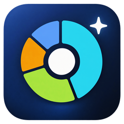

# NANOFreeDisk brand

## Icon

A disk platter seen from above, split into usage segments like a sunburst chart,
with a white hub and a small "free space" sparkle, on a deep-navy rounded square.
It reads as *a disk you can see inside* and stays legible at 16 px.

| File | Use |
|---|---|
| `docs/assets/brand/icon-1024.png` | Master (transparent PNG, 1024 × 1024). Regenerate every other size from this. |
| `docs/assets/brand/icon-256.png` | README, docs |
| `installer/icons/nanofreedisk.ico` | Windows icon: 16, 24, 32, 48, 64, 128, 256 px |
| `apps/nanofreedisk/src-tauri/icons/*` | App/bundle icons (`pnpm tauri icon docs/assets/brand/icon-1024.png -o src-tauri/icons`, then drop `android/` and `ios/`, and re-save `icon.ico` with the sizes above) |
| `apps/nanofreedisk/public/icon.png` | In-app logo (256 px) |

The artwork was generated with an image model from an art-directed prompt (flat
vector, Fluent-inspired, brand palette, no text), then cropped and squared. Keep the
segment colors and proportions when editing; do not add text to the icon.

## Colors

| Token | Hex | Use |
|---|---|---|
| Navy (background) | `#0B1220` | Dark surfaces, icon tile |
| Navy (surface) | `#111C33` | Cards, sidebar in dark theme |
| Cyan | `#22D3EE` | Primary accent, "Analyze" |
| Lime | `#A3E635` | Gradient end, "Clean" |
| Amber | `#F59E0B` | Archives, caution accents |
| Sky | `#60A5FA` | Audio, info |
| Pink | `#F472B6` | Video |

The wordmark is **NANO** in white/text color followed by **FreeDisk** in the accent
color (or the cyan → lime gradient on the banner), Segoe UI / Inter, weight 800.

In the app every color is a theme token (`apps/nanofreedisk/src/lib/theme.ts`): the
NANO Dark / NANO Light presets carry these values, and the Custom theme lets users
change all of them. All built-in presets pass WCAG AA (4.5 : 1) for text — a unit test
enforces it.

## Voice

Plain, calm, specific. Every destructive action says what happens ("moves to the
Recycle Bin and can be restored"), never "optimize" or "boost". English and
Vietnamese are both first-class.
